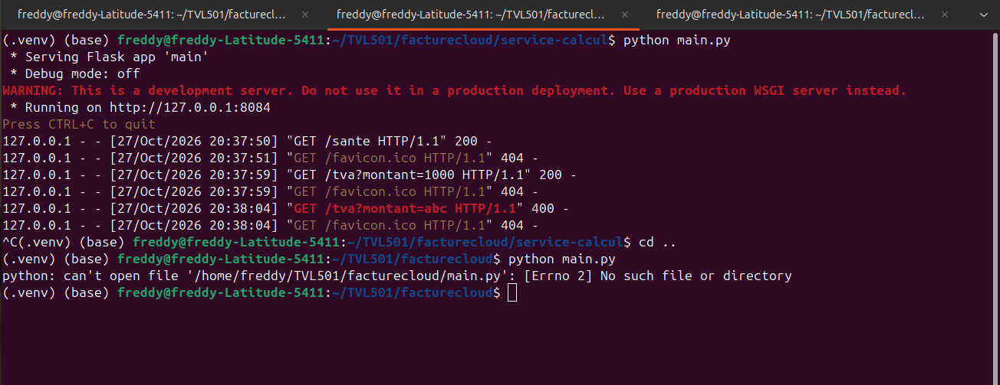
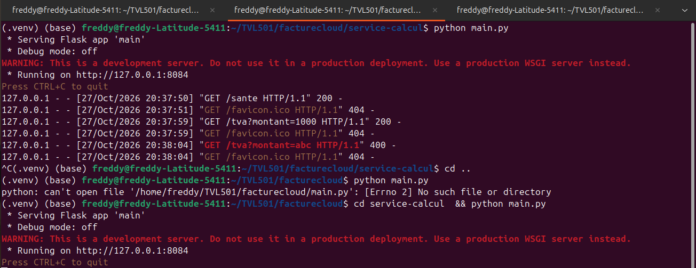
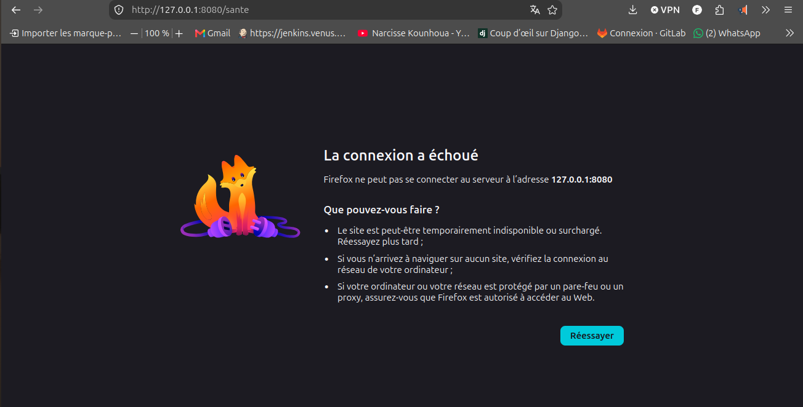
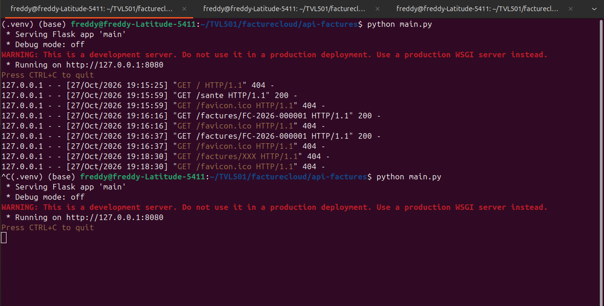
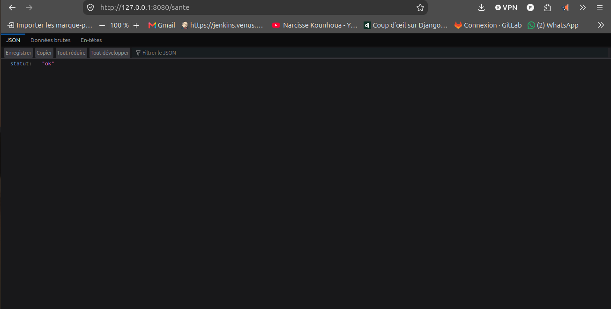

# Journal d'installation - S1

- Binôme : KEPTUKWA NGOUMYIM Freddy Patient
- Date : 27/10/2026
- Système : Ubuntu 24.04.5 LTS

## Versions

- Python : 3.14.6
- Flask : 3.1.3

## Ce que j'ai fait

1. mkdir TVL501  &&  cp -r facturecloud TVL501
2. cd TVL501/facturecloud
3. python --version
4. pip install flask
5. python -m venv .venv
6. source .venv/bin/activate
7. cd api-factures
8. python main.py
9. cd service-calcul   #Ouvert dans un second terminal
10. python main.py

## Ce que j'ai observé

- La fonction sante renvoie : ok code 200
- TVA pour 1000 : {"montant_ht":1000,"tva":193}, code obtenue : 200;
- TVA pour 200 que j'attendais : {"montant_ht":200,"tva":39}, code obtenue : 200

## Problèmes rencontrés
Aucun probleme rencontre lors du travail car etant sur ubuntu j'avais effectue toute les configurations a l'avance ( installation de python, verification...)

## Auto-evaluation

Mon niveau

- Je sais expliquer ce qu'est un service web
- Je sais utiliser un terminal
- Je sais installer Python, VS code et créer un environnement virtuel
- Je sais lancer deux services et les vérifier
- Je sais lire un message d'erreur

## Erreur A : mauvais dossier

1. La cause de l'erreur est que l'on lance main.py dans le mauvais dossier, main.py ne se trouve pas  dans l'emplacement ou l'on le lance.
2. La commande qui permet de corrige est : cd service_calcul

## Erreur B : service arrêté

1. La cause de l'erreur "Connexion a echoue" vient du fait qu'on a arrêté le serveur grace a un ctrl + c, du coup l'acces a la page est impossible
2. La solution pour afficher a nouveau le contenu de la page est de relancer le serveur grace a un python main.py

