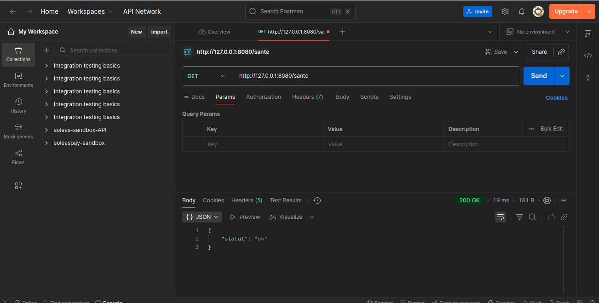
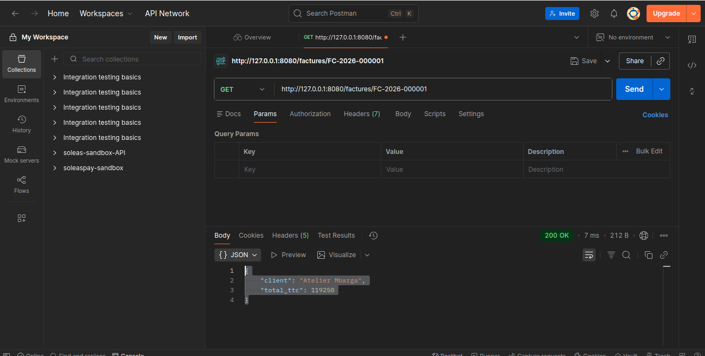
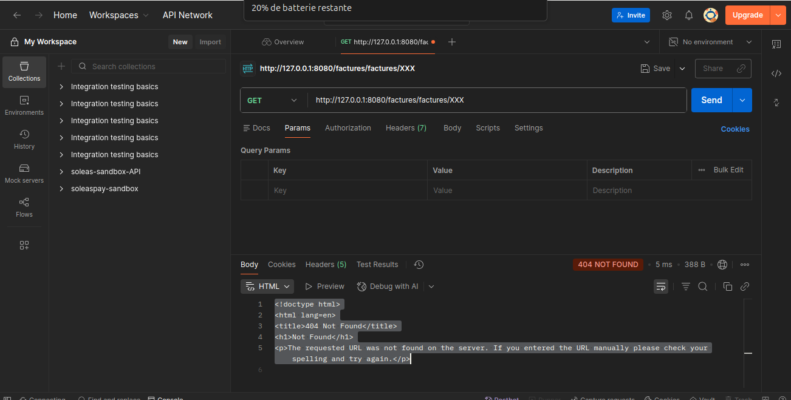
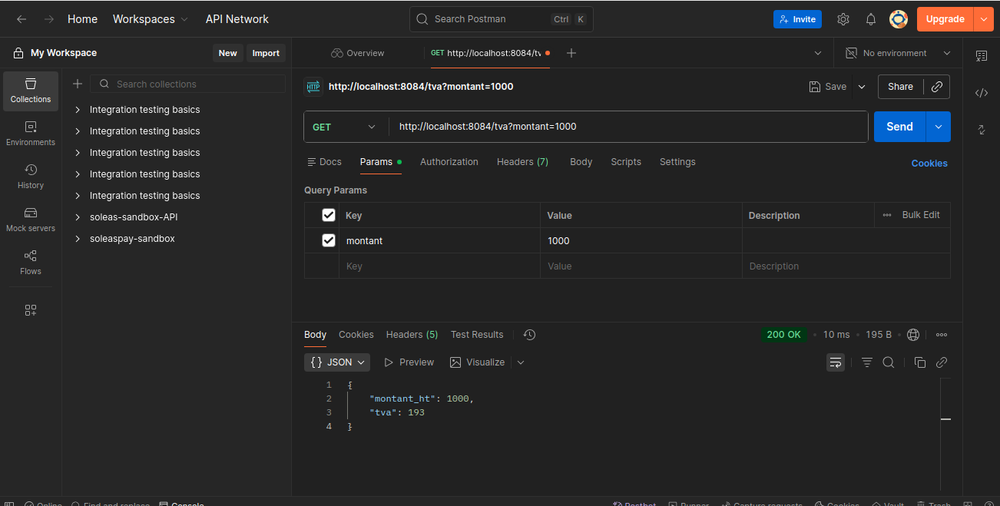
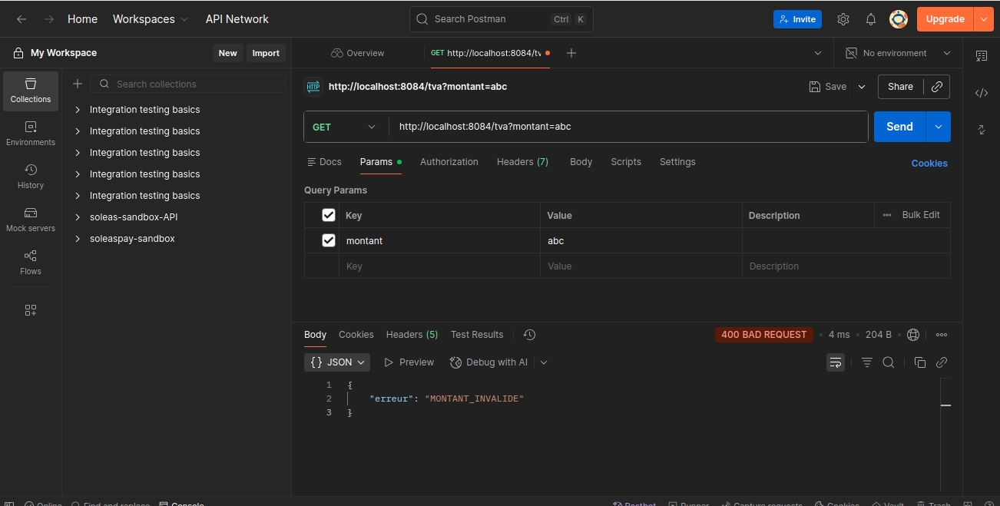

## Appel de base API

Tests des trois appels GET

1. GET http://localhost:8080/sante

```bash
  - Code de la reponse : 200
  - Corps de la reponse : { "statut": "ok" }
  - Observation :L'on observe dans postman que la partie body affiche le code de la reponse ainsi que le corps de la reponse donc la requete s'execute avec succes grace au code 200.

```



2. GET http://localhost:8080/factures/FC-2026-000001

```bash
  - Code de la reponse : 200
  - Corps de la reponse : { "client": "Atelier Mbarga", "total_ttc": 119250 }
  - Observation : L'on observe dans postman dans la partie body le code de la reponse ainsi que le corps de la reponse donc la requete s'execute avec succes grace au code 200.

```


3. GET http://localhost:8080/factures/XXX

```bash
  - Code de la reponse : 404
  - Corps de la reponse : <!doctype html>
<html lang=en>
<title>404 Not Found</title>
<h1>Not Found</h1>
<p>The requested URL was not found on the server. If you entered the URL manually please check your spelling and try again.</p>

  - Observation : L'on observe dans postman une erreur 404, qui signifie que la ressource est introuvable cela traduit que la facture XXX ne fait pas partie des donnees seeds.

```



## Ce que je constate

1. GET http://localhost:8080/factures/FC-2026-000001

Dans cet appel je constate que les cles json sont :

```bash
client
total_ttc

```
- total_ttc est de type : nombre

2. GET http://localhost:8080/factures/XXX

- Dans cet appel le resultat avec le code 404 n'est pas un plantage cela traduit que la ressource est introuvable.
- le code ``` 404``` appartient a la famille ``` 4xx ```
- L'erreur 404 provient du client c'est une ``` erreur cote client ```


## GET http://localhost:8084/tva?montant=1000

- Quel est le port : Le port est ``` 8084```
- Quel est le parametre : Le parametre est ```montant=1000```
- Quelle valeur de TVA obtenez-vous ?  La valeur de la TVA est ``` 193```
- Vérifiez-la à la calculatrice : 19,25% de 1000 : La TVA est de ```192,5```



## GET http://localhost:8081/tva?montant=abc

Apres execution de cette requete on peut analyser de la facon suivante :

- Quel code ? : ``` 400 ```
- pourquoi ? Cet erreur arrive car il y'a une erreur dans la requete le parametre attends un ```nombre``` mais c'est un ```texte``` qui est passee

