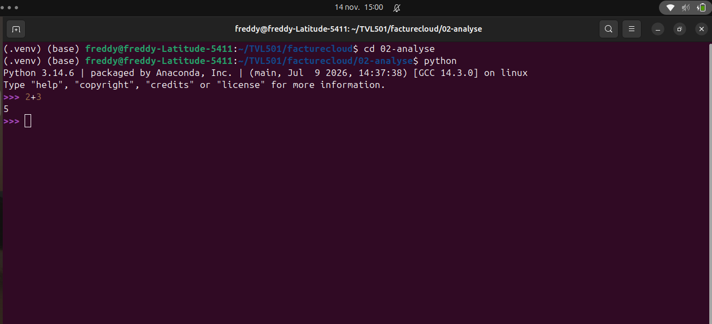

## Membres du groupe
```
KEPTUKWA NGOUMYIM Freddy
TENE Marie-Yanne
```
```Date : 14 Novembre 2026```

## A. Règle de chaque fonction
Analyse des trois fonctions

1. Calculer_tva
   
Cette fonction permet de calculer la TVA sur le montant HT, les valeurs sont arrondies a l'entier le plus proche grace a  ``` round```, pour les valeurs de milieu comme ```59,5``` la valeur arrondie sera : ```60```

2. Total_facture
   
Cette permet de calculer le total de la facture en additionnant les lignes, une ligne est le produit : ```quantite * prix_unitaire```. Si on a zero ligne alors le total sera : ``` Total = 0```

3. Niveau_relance

Cette fonction permet de faire la relance client pour les factures impayees. Les niveaux de relance se decline comme suit :
- Lorsque le nombre de jours de retard est au dela de ```7jours``` alors le niveau de relance est ``` Niveau 1```
- Lorsque le nombre de jours de retard est au dela de ```15jours``` alors le niveau de relance est ``` Niveau 2```
- Lorsque le nombre de jours de retard est au dela de ```30jours``` alors le niveau de relance est ``` Niveau 3```

Resultat du test dans le terminal



## B.Ecriture de l'attendu avant execution

Regle de `calculer_tva` : la TVA vaut 19,25 % du montant HT, arrondie au franc le plus proche ; quand le calcul tombe exactement au milieu (par exemple 88,5), on arrondit vers le haut (89).

| Montant HT | Calcul à la main (montant × 0,1925) | Attendu | Obtenu | Verdict |
|-----------:|:------------------------------------|--------:|--------|---------|
| 100        | 19,25                               | 19      |        |         |
| 150        | 28,875                              | 29      |        |         |
| 200        | 38,5                                | 39      |        |         |
| 600        | 115,5                               | 116     |        |         |
| 1 000      | 192,5                               | 193     |        |         |
| 3 000      | 577,5                               | 578     |        |         |
| 5 000      | 962,5                               | 963     |        |         |