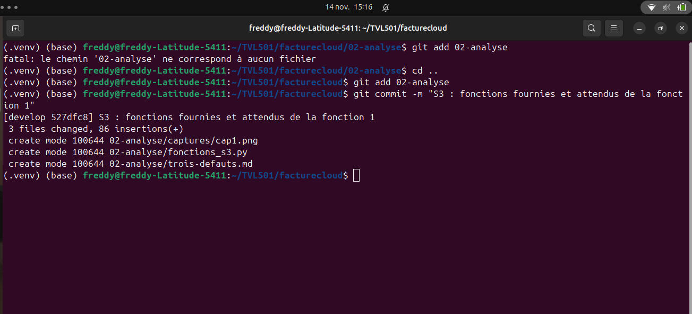
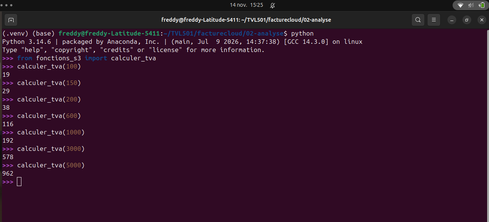
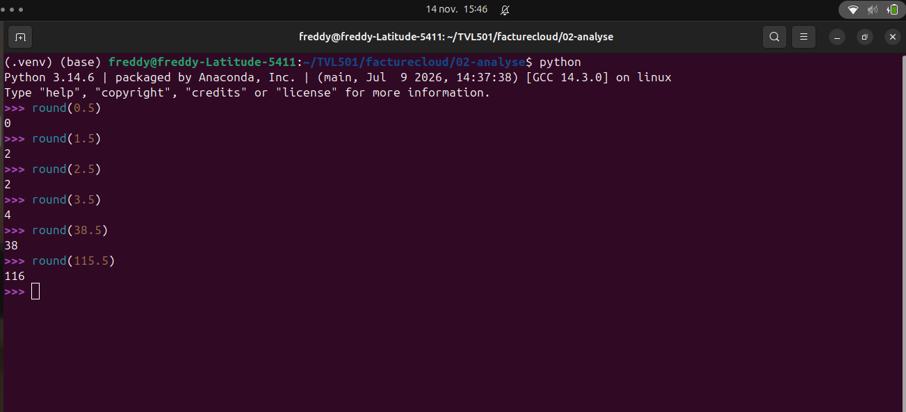
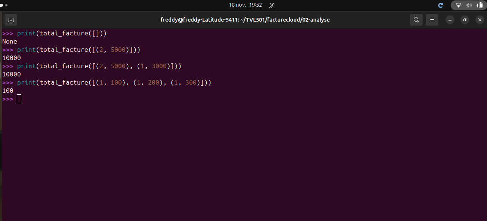
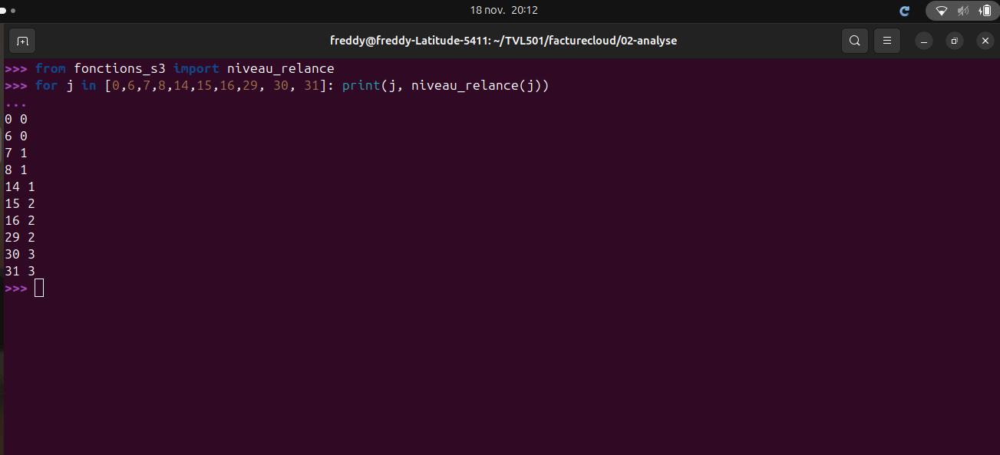
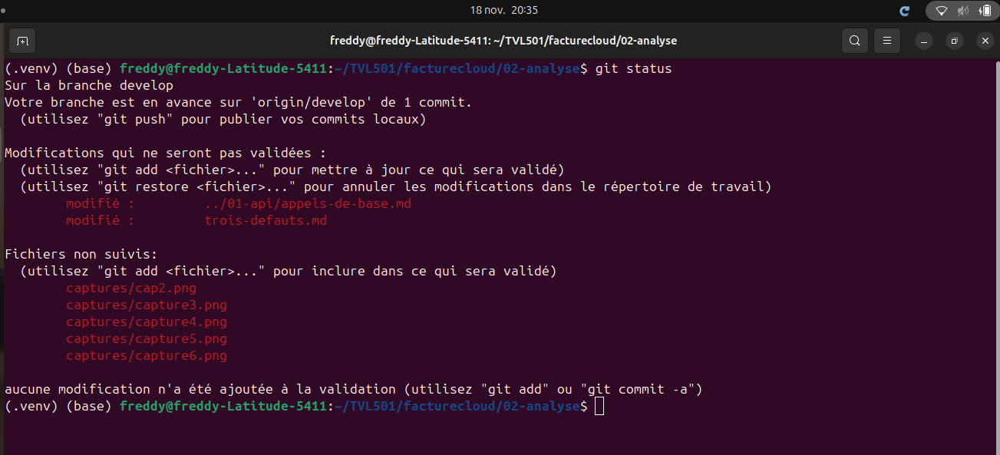
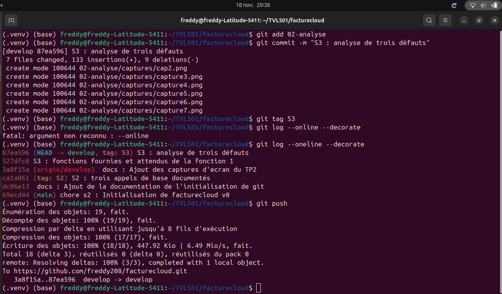

## Membres du groupe
```
KEPTUKWA NGOUMYIM Freddy
TENE Marie-Yanne
```
```Date : 14 Novembre 2026```

## A. Règle de chaque fonction
Analyse des trois fonctions

1. Calculer_tva
   
Cette fonction permet de calculer la TVA sur le montant HT, les valeurs sont arrondies a l'entier le plus proche grace a  ``` round```, pour les valeurs de milieu comme ```59,5``` la valeur arrondie sera : ```60```

2. Total_facture
   
Cette permet de calculer le total de la facture en additionnant les lignes, une ligne est le produit : ```quantite * prix_unitaire```. Si on a zero ligne alors le total sera : ``` Total = 0```

3. Niveau_relance

Cette fonction permet de faire la relance client pour les factures impayees. Les niveaux de relance se decline comme suit :
- Lorsque le nombre de jours de retard est au dela de ```7jours``` alors le niveau de relance est ``` Niveau 1```
- Lorsque le nombre de jours de retard est au dela de ```15jours``` alors le niveau de relance est ``` Niveau 2```
- Lorsque le nombre de jours de retard est au dela de ```30jours``` alors le niveau de relance est ``` Niveau 3```

Resultat du test dans le terminal


## B.Ecriture de l'attendu avant execution

Regle de `calculer_tva` : la TVA vaut 19,25 % du montant HT, arrondie au franc le plus proche ; quand le calcul tombe exactement au milieu (par exemple 88,5), on arrondit vers le haut (89).

| Montant HT | Calcul à la main (montant × 0,1925) | Attendu | Obtenu | Verdict   |
|-----------:|:------------------------------------|--------:|--------|---------  |
| 100        |     19,25                           |   19    |  19    | conforme  |
| 150        |     28,875                          |   29    |  29    | conforme  |
| 200        |     38,5                            |   39    |  38    | écart     |
| 600        |     115,5                           |   116   |  116   | conforme  |
| 1 000      |     192,5                           |   193   |  192   | écart     |
| 3 000      |     577,5                           |   578   |  578   | conforme  |
| 5 000      |     962,5                           |   963   |  962   | écart     |

## C.Fige de l'attendu avec un commit



## D. Execution et notation de l'obtenu



## E.Recherche du motif

1. 
- Les montants qui donnent les ecarts sont : ```200, 1000, 5000```
- Les montants qui sont conformes sont : ```100, 150, 600, 3000```

2. Regardez la colonne Calcul à la main des montants en écart. Que remarquez-vous sur le chiffre
après la virgule ?  L'on remarque que le chiffre apres la virgule est ```5```, et que les nombres en ecarts sont paires.

## Experience et observation 

**Experience**



**Observation**

Cette experience met en evidence le comportement de la fonction `round` : lorsque le nombre est exactement à **mi-chemin**, la fonction round n'arrondit pas toujours vers le haut. Elle applique les regles suivantes :

- Si la partie entiere du nombre est **impaire**, alors ```round``` arrondi le nombre vers l'entier superieur. Exemple : `round(37.5) = 38`
- Si la partie entiere du nombre est **paire**, alors ```round``` arrondi le nombre vers l'entier inferieur. Exemple : `round(64.5) = 64`

**Conséquence  pour valeur conforme et ecart** : La fonction ```calculer_tva()``` est la meme pour tous les nombres  les valeurs **conformes** sont celles ayant la partie entiere **impaire** et celles **ecarts** sont ceux ayant la partie entiere **paire**.


## F. Remonter de la chaîne pour la fonction 1


| Maillon                       | Contenu                                                                                                                                                                                               |
|:------------------------------|:------------------------------------------------------------------------------------------------------------------------------------------------------------------------------------------------------|
| **Défaillance observée**      | Pour un montant HT de 200 FCFA, la fonction renvoie une TVA de 38 au lieu de 39. Même écart de 1 FCFA en moins pour 1 000 (192 au lieu de 193) et pour 5 000 (962 au lieu de 963).                    |
| **Resultat attendu et source**| 39, 193 et 963. La docstring de `calculer_tva` precise que, quand le calcul tombe exactement a mi-chemin, on arrondit vers le haut. Les attendus ont ete calcules avec la calculatrice .        |
| **Défaut**                    | La ligne `return round(tva)` : elle délègue l'arrondi à `round`, dont la regle n'est pas celle demandee.                                                                                              |
| **Erreur probable**           | La personne a cru que `round` arrondit toujours vers le haut a mi-chemin, comme on l'apprend à l'ecole. Elle ne sait pas que `round` de Python arrondit à l'entier pair le plus proche.                  |
| **Origine**                   | Codage                                                                                                                                                                                                |
| **Correction suggéree**       | Remplacer `round(tva)` par un calcul en entiers qui impose « la moitié vers le haut », par exemple `(montant_ht * 1925 + 5000) // 10000`.                                                                |


## Partie C · Les fonctions 2 et 3

## Fonction 2

| Cas | Lignes | Attendu | Obtenu | Verdict |
|:---|:---|:---|:---|:---|
| a | aucune ligne | 0 |None  |  conforme|
| b | une ligne : 2 × 5 000 |  **10 000** |**10 000**  | conforme |
| c | deux lignes : 2 × 5 000 et 1 × 3 000 |  **13 000** | **10 000** | écart |
| d | trois lignes : 1 × 100, 1 × 200, 1 × 300 | **600** | **100** | écart |

**Execution python**




## La chaîne de la fonction 2

| Maillon | Réponse |
|:---|:---|
| **Défaillance observée** | Pour une facture sans ligne, la fonction renvoie `None` au lieu de `0`. Pour deux lignes, elle renvoie `10 000 FCFA` au lieu de `13 000 FCFA`, et pour trois lignes, elle renvoie `100 FCFA` au lieu de `600 FCFA`. |
| **Résultat attendu et sa source** | Le total d'une facture doit être la somme de `(quantité × prix_unitaire)` de toutes les lignes. Une facture sans ligne doit avoir un total de `0`. Cette règle est définie dans l'énoncé de la fonction 2. |
| **Défaut** | L'instruction `return total` est placée à l'intérieur de la boucle `for`, juste après le calcul de la première ligne. |
| **Erreur probable** | La personne a probablement oublié que l'instruction `return` interrompt immédiatement l'exécution de la fonction. Elle a donc retourné le total après le premier calcul au lieu d'attendre que toutes les lignes soient parcourues. |
| **Origine** | codage |
| **Correction suggérée** | Déplacer l'instruction `return total` après la boucle `for` afin que toutes les lignes soient parcourues et additionnées avant de retourner le résultat. |

## La fonction 3 : « niveau_relance »


| Jours de retard | 0 | 6 | 7 | 8 | 14 | 15 | 16 | 29 | 30 | 31 |
|:---|---:|---:|---:|---:|---:|---:|---:|---:|---:|---:|
| **Attendu** | 0 | 0 | 0 | 1 | 1 | 1 | 2 | 2 | 2 | 3 |
| **Obtenu** |  |  |  |  |  |  |  |  |  |  |

**Execution python**



**Résultat de l'exécution :**

| Jours de retard | 0 | 6 | 7 | 8 | 14 | 15 | 16 | 29 | 30 | 31 |
|:---|---:|---:|---:|---:|---:|---:|---:|---:|---:|---:|
| **Attendu** | 0 | 0 | 0 | 1 | 1 | 1 | 2 | 2 | 2 | 3 |
| **Obtenu** | 0 | 0 | 1 | 1 | 1 | 2 | 2 | 2 | 3 | 3 |
| **Verdict** | Conforme | Conforme | Écart | Conforme | Conforme | Écart | Conforme | Conforme | Écart | Conforme |

- Les résultats sont faux pour exactement **3 durées de retard : 7, 15 et 30 jours**.
- Le nombre de valeurs en écart est de **3 sur 10**.

## La chaîne de la fonction 3

| Maillon | Réponse |
|:---|:---|
| **Défaillance observée** | Pour 7 jours de retard, la fonction renvoie le niveau 1 au lieu de 0. Pour 15 jours, elle renvoie le niveau 2 au lieu de 1. Pour 30 jours, elle renvoie le niveau 3 au lieu de 2. Trois valeurs sur dix sont donc en écart. |
| **Résultat attendu et sa source** | Le client demande un niveau 1 au-delà de 7 jours, un niveau 2 au-delà de 15 jours et un niveau 3 au-delà de 30 jours. À 15 jours exactement, le niveau doit rester 1. Cette règle est précisée dans l'énoncé de la fonction 3. |
| **Défaut** | Les trois conditions utilisent l'opérateur `>=` au lieu de `>`, ce qui déclenche les relances dès que le nombre de jours atteint les seuils, au lieu d'attendre qu'il les dépasse. |
| **Erreur probable** | Le développeur a probablement confondu « au-delà de » avec « à partir de » et a donc considéré que les seuils de 7, 15 et 30 jours étaient inclus dans les conditions de déclenchement. |
| **Origine** | codage |
| **Correction suggérée** | Remplacer les opérateurs `>=` par `>` dans les trois conditions afin de respecter les seuils définis par le client. |

si le client n'avait pas donné son exemple,
auriez-vous pu dire qui a raison, le code ou la règle ? Que feriez-vous avant de déclarer un défaut ?

**Réponses :**

Oui j'aurais pu dire qui a raison car la regle de la fonction est bien claire elle mentione **au-delà**, donc on comprend ce qu'il faut faire.

Avant de déclarer un défaut, j'aurais réalisé des tests sur plusieurs cas afin d'évaluer le comportement du code. J'aurais également demandé au client de fournir des cas concrets pour mieux expliciter sa logique métier, clarifier les résultats attendus et identifier plus précisément les éventuelles défaillances du code.

## Répondre à la direction

La Quincaillerie Mbarga a signalé une erreur dans le calcul de la TVA sur certaines factures. Le problème vient de la méthode d'arrondi utilisée, qui ne respecte pas toujours la règle prévue : **arrondir la moitié vers le haut.** Les écarts concernent les montants HT de 200 FCFA (38 au lieu de 39), 1 000 FCFA (192 au lieu de 193) et 5 000 FCFA (962 au lieu de 963). Nous proposons de corriger la méthode d'arrondi et de réaliser de nouveaux tests avant sa mise en service.

## Commit, étiquette et envoi






