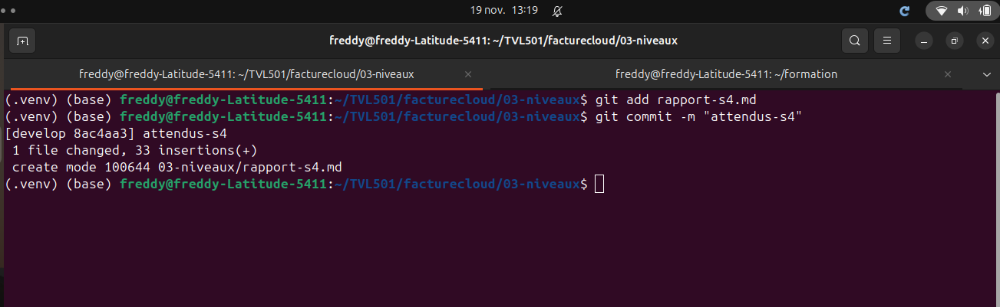
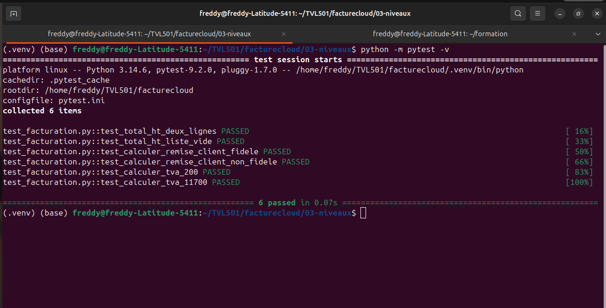
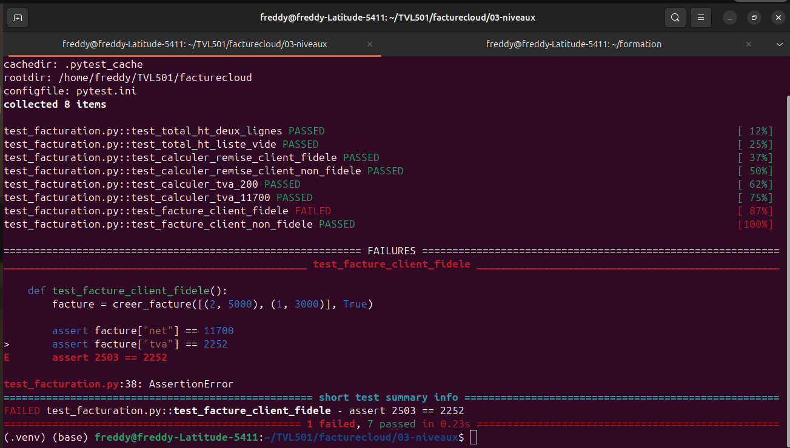

## Tests des composants & tests d'intregration

## Membres du groupe
```
KEPTUKWA NGOUMYIM Freddy
TENE Marie-Yanne
```
```Date : 19 Novembre 2026```

## A. Les attendus

## 1. Niveau composant

| Fonction | Entrée | Attendu | Source de l'attendu |
|:---|:---|---:|:---|
| `total_ht` | `[(2, 5000), (1, 3000)]` | 13 000 FCFA | Le total HT d'une facture est la somme de quantité × prix unitaire de chaque ligne. |
| `total_ht` | `[]` | 0 FCFA | Le total HT d'une facture est la somme de quantité × prix unitaire de chaque ligne. |
| `calculer_remise` | `(13000, True)` | 1 300 FCFA | La remise est de 10 % du total HT pour un client fidèle, 0 sinon. |
| `calculer_remise` | `(13000, False)` | 0 FCFA | La remise est de 10 % du total HT pour un client fidèle, 0 sinon. |
| `calculer_tva` | `200` | 39 FCFA | La TVA est de 19,25 % du montant HT après remise. Elle est arrondie à l'entier le plus proche, 0,5 arrondi vers le haut. |
| `calculer_tva` | `11700` | 2 252 FCFA | La TVA est de 19,25 % du montant HT après remise. Elle est arrondie à l'entier le plus proche, 0,5 arrondi vers le haut. |


## 2. Niveau intégration

| Fonction | Entrée | Client fidèle | Client non fidèle |
|:---|:---|---:|---:|
| `creer_facture` | `([(2, 5000), (1, 3000)], client_fidele)` |  |  |
| HT | Calcul du total des lignes | 13 000 FCFA | 13 000 FCFA |
| Remise | 10 % si client fidèle, sinon 0 | 1 300 FCFA | 0 FCFA |
| Net | HT − remise | 11 700 FCFA | 13 000 FCFA |
| TVA | 19,25 % du net, arrondie au franc | 2 252 FCFA | 2 503 FCFA |
| TTC | Net + TVA | 13 952 FCFA | 15 503 FCFA |

**Execution git**



## B. Tests au niveau composant

**Execution des test**




### Résultats de l'exécution des tests

La commande `python -m pytest -v` a permis d'executer les six tests de composants.

| N° | Test | Résultat |
|---|---|---|
| 1 | `test_total_ht_deux_lignes` | **Réussi** |
| 2 | `test_total_ht_liste_vide` | **Réussi** |
| 3 | `test_calculer_remise_client_fidele` | **Réussi** |
| 4 | `test_calculer_remise_client_non_fidele` | **Réussi** |
| 5 | `test_calculer_tva_200` | **Réussi** |
| 6 | `test_calculer_tva_11700` | **Réussi** |

**Bilan :** 6 tests réussis sur 6. Aucun échec n'a été constaté lors de cette exécution.


## C. Test au niveau intégration

**Execution des tests**



### Analyse des résultats des tests d'intégration

**Message d'échec affiché par Pytest :**

```json
FAILED test_facturation.py::test_facture_client_fidele
- assert 2503 == 2252

test_facturation.py:38: AssertionError
```

**Analyse de l'échec :**

Dans le test `test_facture_client_fidele`, l'assertion suivante échoue :

```python
assert facture["tva"] == 2252
```

La fonction retourne une TVA de 2 503 FCFA au lieu des 2 252 FCFA attendus. Il existe donc un écart de 251 FCFA entre le résultat obtenu et le résultat attendu.

**Verdict des tests d'intégration :**

| Test | Résultat obtenu | Verdict |
|---|---|---|
| `test_facture_client_fidele` | TVA obtenue : 2 503 FCFA au lieu de 2 252 FCFA | **Écart** |
| `test_facture_client_non_fidele` | Toutes les valeurs attendues sont obtenues | **Conforme** |

**Bilan :** sur les deux tests d'intégration, un test est conforme et un test présente un écart.


## Analyse et conclusion

### 17. Fiche d'analyse de l'écart

| Rubrique | Analyse |
|---|---|
| **Défaillance observée** | Pour une facture destinée à un client fidèle, la fonction `creer_facture` retourne une TVA de 2 503 FCFA au lieu de 2 252 FCFA. Le montant net après remise est pourtant correct : 11 700 FCFA. |
| **Résultat attendu et source** | La TVA attendue est de 2 252 FCFA, car elle doit être calculée sur le montant HT après remise : 11 700 × 19,25 % = 2 252,25, arrondi à 2 252 FCFA. Source : règle de gestion du module FactureCloud indiquant que la TVA est calculée sur le montant HT après remise. |
| **Défaut** | Dans la fonction `creer_facture`, l'instruction `tva = calculer_tva(ht)` utilise le montant HT avant remise au lieu du montant net après remise. Elle se trouve à la ligne 32 du code fourni. |
| **Erreur probable** | Le développeur a probablement utilisé la variable `ht` au lieu de `net`, en oubliant que la règle métier impose de calculer la TVA après application de la remise. |
| **Origine** | **Codage** : la règle métier est correctement définie, mais son application dans le code est incorrecte. |
| **Correction suggérée** | Remplacer `tva = calculer_tva(ht)` par `tva = calculer_tva(net)` afin de calculer la TVA sur le montant après remise. |

**Pourquoi les tests de composants n'ont-ils pas détecté ce défaut ?**

Les tests au niveau composant n'ont pas détecté ce défaut parce qu'ils vérifiaient séparément le fonctionnement de ```calculer_tva```, sans vérifier que creer_facture lui transmettait le montant après remise. Le défaut est apparu au niveau intégration et illustre le principe selon lequel des composants fonctionnant correctement individuellement ne garantissent pas le bon fonctionnement de leur combinaison.

**Vérification ou validation ?**

Il s'agit de la **vérification**, car nous contrôlons que l'implémentation de creer_facture respecte la règle de gestion explicitement définie dans les spécifications. L'on ne vérifie pas si la fonctionnalité repond au besoin du client.

## Auto-evaluation

Cet exercice nous a permis de comprendre en mieux et de mettre en pratique les notions de **test de composants** et  **test d'integration**